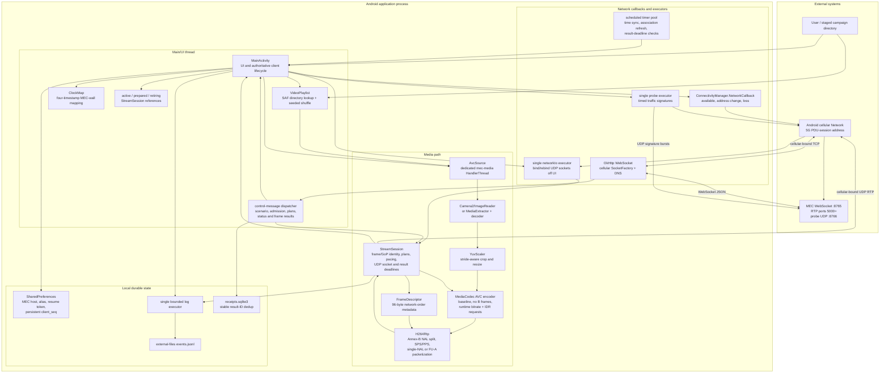

# Android UE implementation diagrams

Audited 2026-11-02 from
`multi-ue/ue/android/app/src/main/java/edu/clemson/mecrtp/`. The Android UE is
a foreground research client. It explicitly acquires an Android cellular
`Network` and binds control, RTP, and association-probe traffic to that
network.

## Components and concurrency



`MainActivity` owns the control state and active-session references. The media
pipeline runs on `AvcSource`'s `HandlerThread`. Socket creation and rebinding
run on `networkIo`, probes have their own executor, and evidence uses a bounded
single-thread executor so UI and media callbacks do not perform file I/O.

## Connection, assignment, and recovery lifecycle

```mermaid
sequenceDiagram
  autonumber
  participant U as User / MainActivity
  participant C as ConnectivityManager
  participant N as Cellular Network
  participant W as OkHttp WebSocket
  participant M as MEC
  participant S as StreamSession / AvcSource

  U->>C: requestNetwork(CELLULAR + INTERNET)
  C-->>U: onAvailable(Network)
  C-->>U: onLinkPropertiesChanged(12.1.1.x)
  U->>W: connect with Network SocketFactory and saved resume token
  W->>M: GET /ws/ue
  M-->>W: mec_hello(UE ID, connection ID, resume token, profile)
  W-->>U: message posted to UI thread
  U->>U: persist resume token; start time-sync samples
  U->>M: association_update(alias, cellular IP, clock mapping)

  M-->>U: scenario_context(context, assignment)
  U->>U: resolve assigned media filename in selected directory
  U->>M: scenario_context_ack with immutable context
  M-->>U: scenario_start(start time, relative release delay)
  U->>U: calculate local release from UE clock
  U->>M: video_start(client_seq, candidate, media segment)
  M-->>U: video_response(endpoint, config, media epoch)
  U->>S: create session; bind UDP socket to cellular Network
  U->>S: start decoder/encoder during lead interval
  S->>S: hold first frame until common release
  S->>M: RTP/H.264 frames

  S-->>U: media_end(final frame)
  U->>M: video_end with persistent client_seq
  M-->>U: video_end_ack and terminal video_status
  U->>U: retire session for late result receipts

  alt WebSocket failure or cellular address change
    W-->>U: onFailure / onClosed, or Network callback
    U->>U: clear displayed frame counters
    U->>W: reconnect after 500 ms with same resume token
    M-->>U: mec_hello plus durable replay
    U->>M: resend pending video_end if unacknowledged
  end

  alt cellular Network lost
    C-->>U: onLost
    U->>W: cancel control socket
    U->>U: wait for a new cellular Network
  end
```

The persistent `client_seq` makes lifecycle retries idempotent at the MEC.
`pendingEnd` survives control reconnects until acknowledged. Frame results use
stable `result_id` values and are deduplicated in SQLite before receipt evidence
is recorded.

## Prerecorded-frame and RTP path

```mermaid
flowchart LR
  DIR["SAF campaign directory"] --> FIND["VideoPlaylist.find(media_path filename)"]
  FIND --> EXT["MediaExtractor<br/>select video track and seek<br/>to previous sync sample"]
  EXT --> DEC["MediaCodec decoder<br/>discard decoded frames before<br/>source_start_frame time"]
  DEC --> PACE["pace by source PTS and<br/>scenario release boundary"]
  PACE --> HOLD{"StreamSession.prepare<br/>release reached, no AU in flight,<br/>not suspended?"}
  HOLD -->|"wait in collection mode"| PACE
  HOLD -->|"yes"| YUV["YuvScaler to configured 1280x720 YUV"]
  YUV --> CFG["apply bitrate change and<br/>request IDR at GoP/config boundary"]
  CFG --> ENC["MediaCodec H.264 baseline encoder"]
  ENC --> AU["encoded access unit"]
  AU --> CHECK{"commanded IDR present?"}
  CHECK -->|"no"| ERROR["sender_error; close collection input"]
  CHECK -->|"yes"| META["StreamSession.begin<br/>assign frame/GoP/config/plan IDs,<br/>record transmitted event"]
  META --> DESC["FrameDescriptor.encode<br/>96 bytes"]
  AU --> PACK["H264Rtp<br/>repeat SPS/PPS on IDR,<br/>single NAL or FU-A"]
  DESC --> PACK
  PACK --> UDP["DatagramSocket bound to<br/>Android cellular Network"]
  UDP --> MEC["MEC RTP receiver"]

  MEC -->|"frame_result over WebSocket"| DEDUP["receipts.sqlite3 result-ID check"]
  DEDUP --> OWNER["active or retiring StreamSession"]
  OWNER --> LAT["UE monotonic latency,<br/>outcome and SLO evidence"]
  LAT --> LOG["events.jsonl"]
```



For a collection segment, the decoder retries a decoded source frame while the
encoder or previous access unit is busy instead of consuming it. It stops only
after the manifest-selected frame count has been submitted and verifies that
the encoder produced the required last frame.

## Files and responsibilities

| File | Primary responsibility |
|---|---|
| `MainActivity.java` | UI, cellular acquisition, WebSocket lifecycle, scenario protocol, probes, session handoff and evidence routing |
| `AvcSource.java` | Camera or prerecorded decode, pacing, YUV preparation, AVC encoding and segment completion |
| `StreamSession.java` | Media identity, configuration boundaries, frame numbering, pacing, UDP socket, result latency and deadline evidence |
| `H264Rtp.java` | RFC 6184 packetization with the 96-byte descriptor repeated in an RTP header extension |
| `FrameDescriptor.java` | Shared version-1 binary descriptor serialization |
| `ClockMap.java` | Minimum-RTT four-timestamp mapping from UE monotonic time to MEC wall time |
| `VideoPlaylist.java` | Campaign filename lookup and nonrepeating seeded shuffle outside collection mode |
| `YuvScaler.java` | Stride-aware YUV crop and resize into encoder input buffers |

## Interpretation boundaries

- Android binds each application socket to the acquired cellular `Network`;
  it does not rely on Android's default route.
- Collection preparation retains the first decoded frame and then acknowledges
  readiness. `scenario_start` releases it immediately; duplicate starts are
  ignored. Absolute wall timestamps remain evidence and descriptor metadata.
- `encoded_bytes` is canonical H.264 access-unit size. It excludes RTP/UDP/IP
  and radio-layer overhead.
- The app measures result latency on the UE monotonic clock. Clock mapping is
  used for cross-host evidence, not for the latency subtraction.
- Camera mode exists, but the campaign path uses staged prerecorded files and
  deterministic source segments.

