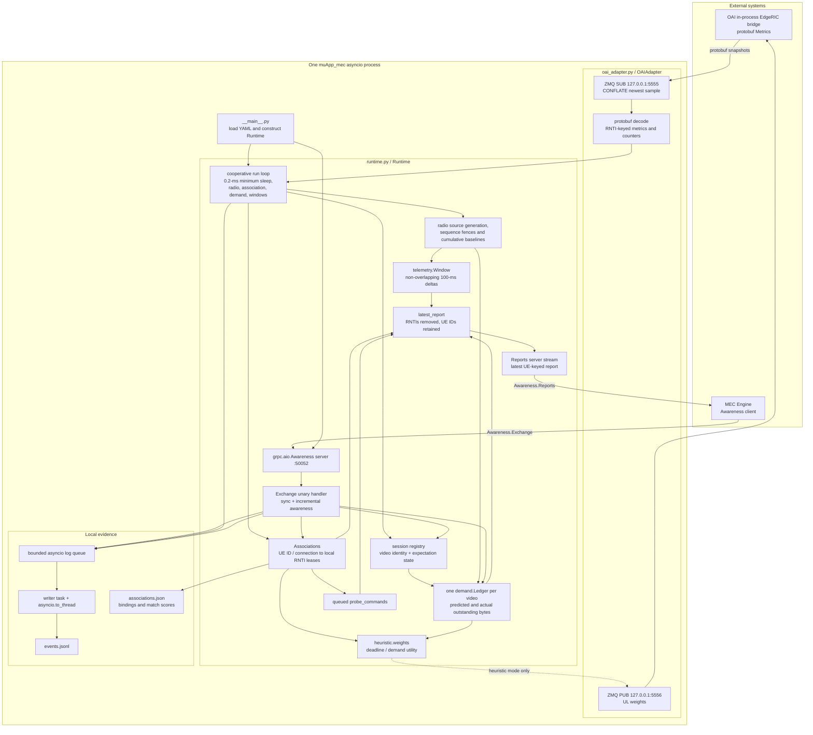
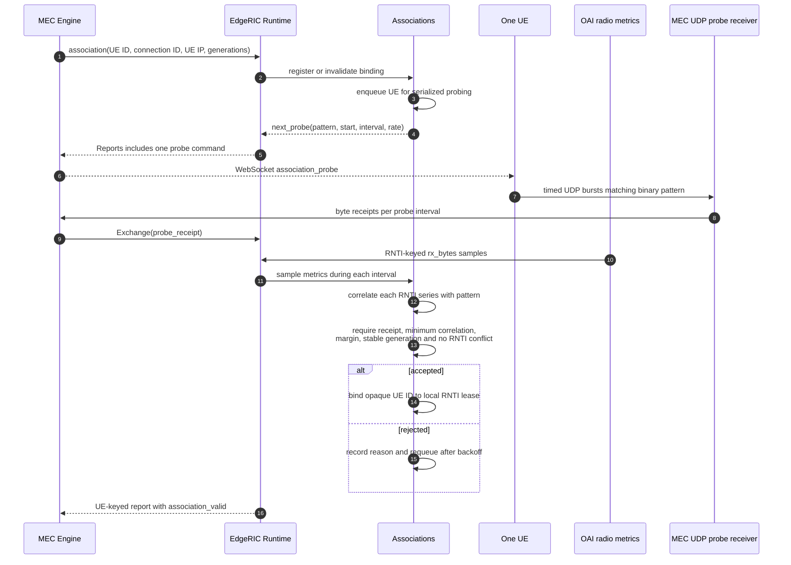
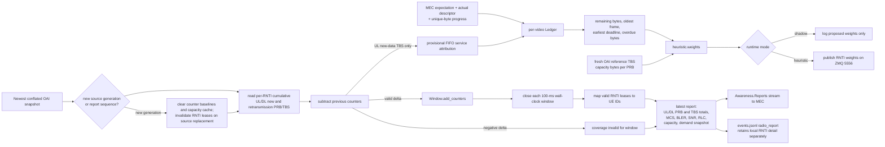

# EdgeRIC `muApp_mec` implementation diagrams

Audited 2026-11-02 from `EdgeRIC-v2/muApp_mec/`. This is the EdgeRIC path used
by the multi-UE collection system. It is separate from the historical Redis
muApps and from the optional FlexRIC nearRT-RIC monitor path.

## Runtime architecture



The OAI SUB socket is conflated, so EdgeRIC does not assume that it receives
every scheduler snapshot. Correct window totals come from differences between
cumulative counters published by OAI. The first sample of a radio generation
establishes a baseline and is not charged to the current window.

## MEC awareness and state reconciliation

```mermaid
sequenceDiagram
  autonumber
  participant M as MEC Engine
  participant G as gRPC Awareness server
  participant R as Runtime.exchange
  participant A as Associations
  participant S as Session registry
  participant L as Demand Ledger

  M->>G: Exchange(sync, awareness_generation, revision, context, associations, sessions)
  G->>R: exchange(message)
  R->>R: validate schema and complete attempt context
  alt new MEC awareness generation or run
    R->>R: retire old generation; clear sessions and bindings
  end
  alt new campaign/scenario/attempt context
    R->>R: clear radio baselines, window and latest report
  end
  R->>A: reconcile authoritative association snapshot
  loop each active session
    R->>S: merge UE/video/media epoch and control state
    S->>L: merge expectation, outstanding descriptors and progress
  end
  R-->>M: synced with EdgeRIC source_generation

  M->>G: Exchange(association/session/descriptor/progress/reception_loss/mec_resources)
  G->>R: exchange(incremental message)
  R->>R: reject stale revision, generation or scenario context
  alt association
    R->>A: register connection generation and IP
  else session or descriptor
    R->>S: validate media identity
    S->>L: update predicted or actual demand
  else progress
    R->>L: advance confirmed unique bytes; retire when complete
  else probe receipt
    R->>A: attach MEC receipt evidence to active probe
  end
  R-->>M: ok / stale / retired
```

The authoritative `sync` is the recovery mechanism for a dropped incremental
message or an MEC restart. `awareness_generation` separates MEC processes;
`awareness_revision` fences stale incremental updates; and the campaign,
scenario, and attempt IDs prevent evidence from being relabeled across runs.

## UE-to-RNTI association



Only one signature probe is active at a time. This prevents simultaneous UEs
from producing ambiguous correlations, but makes initial four-UE association
inherently sequential. RNTIs and correlation scores remain in local EdgeRIC
evidence; reports sent to MEC are keyed by opaque UE ID.

## Radio counters, demand attribution and reports



Confirmed MEC unique-byte progress and provisionally estimated radio service
are never added together. `FrameDemand.remaining` subtracts the larger of the
two, limiting double credit. Scheduled TBS remains telemetry; it does not
become proof that application bytes arrived.

## Files and responsibilities

| File | Primary responsibility |
|---|---|
| `__main__.py` | YAML loading, OAI adapter construction and asyncio runtime entry point |
| `runtime.py` | gRPC service, awareness reconciliation, main radio loop, demand prediction, window publication and optional actions |
| `oai_adapter.py` | Conflated protobuf ZMQ input and scheduling-weight ZMQ output |
| `association.py` | Serialized probe generation, correlation, lease/revalidation and conflict checks |
| `demand.py` | Per-video frame-demand ledger, actual/provisional byte accounting and compact retirement tombstones |
| `telemetry.py` | 100-ms counter aggregation; also contains the older offline CSV trace reader |
| `heuristic.py` | Demand/deadline utility transformed into normalized UE weights |
| `legacy_wire/*.proto` | Protobuf schema used on the local OAI ZMQ boundary |

## Active-campaign interpretation

- The current collection campaign uses `shadow` mode. The heuristic is
  evaluated and may be logged, but `OAIAdapter.send()` is not called.
- OAI therefore continues with its configured PF scheduler. EdgeRIC is an
  observer and association/telemetry service for this campaign.
- `Window` values are 100-ms aggregates derived from cumulative scheduler
  counters. They are neither per-slot logs nor per-frame measurements.
- `throughput_bytes_s` is a payload-fraction conversion from scheduled
  new-data TBS. It is distinct from MEC received unique bytes and UE-observed
  application results.
- A report before a valid association has unavailable UE attribution. Null
  radio state and zero attributable grants in that row must not be interpreted
  as a measured zero-quality radio link.

