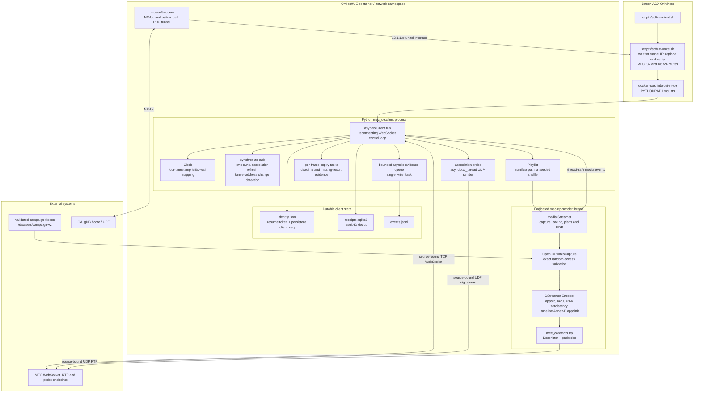

# Linux softUE client implementation diagrams

Audited 2026-11-02 from `multi-ue/ue/linux/src/mec_ue/` and the launch wrappers
in `multi-ue/scripts/`. The application client runs inside the already-running
OAI softUE container. It does not implement NR or configure the B210; OAI owns
the radio and exposes the PDU-session tunnel as `oaitun_ue1`.

## Deployment, process, and concurrency



The shell wrapper first installs and validates cellular routes, then uses
`docker exec` so all application sockets share the softUE network namespace.
The Python control plane is asyncio-based. A dedicated thread owns video
capture, GStreamer encoding, pacing, and RTP transmission; it reports events
back with `loop.call_soon_threadsafe`.

## Control and scenario lifecycle

```mermaid
sequenceDiagram
  autonumber
  participant H as softue-client.sh
  participant R as softue-route.sh
  participant C as Client asyncio loop
  participant M as MEC
  participant S as Streamer thread

  H->>R: establish cellular application routes
  R->>R: discover oaitun_ue1 IPv4 address
  R->>R: ip route replace MEC /32 and N6 /26
  R-->>H: verify route device and source address
  H->>C: docker exec python -m mec_ue.client

  loop until stopped
    C->>C: refresh tunnel source IP and MEC route
    C->>M: source-bound WebSocket connect with saved resume token
    M-->>C: mec_hello
    C->>C: persist identity and client_seq state
    C->>M: repeated time_sync and association_update

    M-->>C: scenario_context with assignment
    C->>C: set immutable context, application and media path
    C->>M: scenario_context_ack
    M-->>C: scenario_start with relative release delay
    C->>M: video_start using persistent client_seq
    M-->>C: accepted video_response and RTP endpoint
    C->>S: create Streamer with source segment and release timestamp
    S->>M: paced RTP/H.264 frames
    S-->>C: transmitted events and media_end
    C->>M: video_end(final frame, same retryable client_seq)
    M-->>C: frame results and terminal video_status
  end

  alt control socket fails or tunnel address changes
    C->>C: record control_reconnect; wait 500 ms
    C->>C: rediscover source IP and refresh route
    C->>M: reconnect with resume token
    C->>M: resend pending video_end
    M-->>C: replay durable frame results
  end

  alt media sender fails
    S-->>C: sender_error
    C->>C: set fatal_media_error and stop
    C->>M: close WebSocket with code 1011
    C-->>H: process exits nonzero for host supervision
  end
```

Unlike an Android process, the Linux client has no platform cellular callback.
It checks `oaitun_ue1` before every control connection and during
`synchronize()`. If a PDU reattach changes the source address, it closes the
control socket, refreshes the route, and reconnects.

## Media, packetization, and result path

```mermaid
flowchart LR
  ASSIGN["scenario assignment<br/>media path, source start, 150 frames"] --> CAP["OpenCV VideoCapture"]
  CAP --> SEEK{"exact source-frame seek?"}
  SEEK -->|"no"| FATAL["sender_error and client exit"]
  SEEK -->|"yes"| RELEASE["wait for common release and<br/>per-frame 30-fps deadline"]
  RELEASE --> CTRL{"pending config boundary<br/>or suspension?"}
  CTRL -->|"suspended"| GRAB["cap.grab; advance source frame ID"]
  GRAB --> RELEASE
  CTRL -->|"active"| READ["cap.read and resize"]
  READ --> ENC["GStreamer x264 Encoder.frame<br/>apply bitrate and force key unit"]
  ENC --> NALS["Annex-B NAL access unit"]
  NALS --> IDR{"required IDR produced?"}
  IDR -->|"no"| FATAL
  IDR -->|"yes"| DESC["Descriptor<br/>video/frame/GoP/config/plan,<br/>encoded bytes and timestamps"]
  NALS --> PACK["packetize single-NAL / FU-A<br/>repeat descriptor on every packet"]
  DESC --> PACK
  PACK --> UDP["UDP socket bound to current<br/>oaitun_ue1 source IP"]
  UDP --> MEC["MEC RTP receiver"]
  UDP --> TX["transmitted event + expiry task"]

  MEC -->|"frame_result over WebSocket"| DEDUP["receipts.sqlite3 result-ID dedup"]
  DEDUP --> LOOKUP["match video_id and frame_id<br/>to transmitted record"]
  LOOKUP --> LAT["UE monotonic result latency,<br/>deadline and SLO outcome"]
  TX --> LOG["events.jsonl"]
  LAT --> LOG
```



The Linux campaign path deliberately requires an exact OpenCV random-access
seek. This is why the staged campaign videos are prevalidated at every segment
boundary. A mismatched or undecodable segment is a fatal sender error rather
than silently generating a different workload.

## Files and responsibilities

| File | Primary responsibility |
|---|---|
| `client.py` | Persistent identity, WebSocket reconnect loop, scenario protocol, clock/association, result accounting and evidence writer |
| `media.py` | OpenCV source, GStreamer x264 encoder, pacing/configuration state, descriptor construction and RTP transmission |
| `playlist.py` | Supported-file discovery and reproducible nonrepeating shuffle when a manifest assignment does not directly override the media path |
| `scripts/softue-route.sh` | Discover the current tunnel IP and enforce MEC/N6 routing through `oaitun_ue1` |
| `scripts/softue-client.sh` | Apply routes and start the Python client inside the softUE container namespace |

## Interpretation boundaries

- `nr-uesoftmodem` and `mec_ue.client` are separate processes with separate
  responsibilities. The client consumes the PDU tunnel; it does not control NR
  attachment or radio scheduling.
- The management `eth0` route remains available, but the wrapper refuses to
  start if MEC or N6 traffic would use it.
- OpenCV supplies decoded application frames; GStreamer performs only the
  outgoing low-latency H.264 encode in this client.
- The relative scenario release is converted using the UE clock and avoids
  absolute clock-map offset skew. Descriptor wall timestamps are marked invalid
  when the clock mapping is stale.
- `encoded_bytes` excludes RTP/UDP/IP and radio overhead. Achieved application
  bitrate and scheduled radio throughput must therefore remain distinct.

