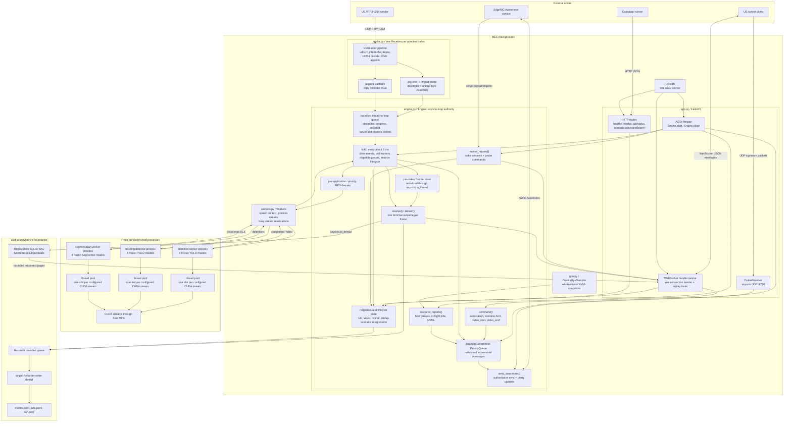

# MEC implementation diagrams

Audited 2026-11-02 from `multi-ue/mec/src/mec_server/`. These diagrams show
the implemented concurrency boundaries and call paths. They describe both
collection mode and the adaptive code that remains available in development
or experimental mode. The active collection campaign fixes the candidate per
UE assignment and CUDA priority at `-3`.

## Process and concurrency architecture



The critical ownership rule is that the asyncio loop owns `ues`, `videos`,
`frames`, pending queues, and lifecycle transitions. GStreamer callbacks and
worker processes never mutate those registries directly. They report through
bounded queues, and `Engine.tick()` applies the changes on the loop.

## Scenario and control lifecycle

```mermaid
sequenceDiagram
  autonumber
  participant R as Campaign runner
  participant A as FastAPI routes
  participant E as Engine
  participant W as UE WebSocket handler
  participant U as UE client
  participant X as EdgeRIC

  U->>W: Open /ws/ue with optional resume token
  W->>E: hello(resume token, peer IP, enqueue)
  E-->>W: hello envelope, UE ID and resume token
  E->>X: association update through awareness queue
  W-->>U: hello
  U->>W: association_update(alias, UE IP, clock map)
  W->>E: command()
  E->>X: revisioned association update
  E-->>U: association_pending

  R->>A: POST /api/scenario/arm
  A->>E: arm_scenario(context, assignments)
  E->>E: require idle; reset attempt state
  E->>X: authoritative sync requested
  E-->>U: scenario_context with alias assignment
  U->>W: video_start(client_seq, assignment IDs)
  W->>E: command() with client-sequence dedup
  E->>E: start_video; validate assignment/candidate
  E->>X: session and demand expectation
  E-->>U: admission response and RTP port
  U->>U: prepare media and hold first frame
  U->>W: scenario_context_ack(video_id)
  W->>E: validate context, admitted video and connection generation
  E-->>U: scenario_context_acknowledged

  R->>A: POST /api/scenario/start
  A->>E: await start_scenario(context)
  E->>E: require every assigned alias ready
  E-->>U: queue scenario_start for all participants
  E->>E: check local writes; 0.2 s then one retry stage
  U->>U: release immediately without a start ACK

  U->>W: video_end(final_frame_id)
  W->>E: end_video
  E->>E: close input, resolve gaps, drain work/results
  E-->>U: terminal video_status
  R->>A: poll /api/status until terminal accounting
  R->>A: POST /api/scenario/disarm
  A->>E: require fully idle, then clear authority
```

`client_seq` deduplicates `video_start` and `video_end` retries. Scenario
messages additionally carry `campaign_id`, `scenario_id`, and `attempt_id`.
A UE is usable for a release only after its current WebSocket generation has
acknowledged that exact attempt.

## Frame ingestion and terminal-result path

```mermaid
flowchart LR
  PKT["RTP packet"] --> PARSE["parse 96-byte descriptor<br/>before jitter buffer"]
  PARSE --> ASM["Assembly keyed by frame_id<br/>deduplicate payload ranges"]
  ASM --> DESC["descriptor event<br/>create Frame in RECEIVING"]
  ASM --> PROG["progress event<br/>unique bytes / completion"]
  PARSE --> JIT["GStreamer jitterbuffer"]
  JIT --> DEP["H.264 depay + parse + decode"]
  DEP --> RGB["RGB appsink callback"]

  DESC --> EQ["Engine event queue"]
  PROG --> EQ
  RGB --> EQ
  EQ --> RX["Engine.tick"]

  RX --> VALIDATE{"descriptor, video epoch,<br/>config and plan valid?"}
  VALIDATE -->|"no"| FAIL["failed terminal result"]
  VALIDATE -->|"yes"| READY{"decoded RGB available?"}
  READY -->|"no / expires or closes"| FAIL
  READY -->|"yes"| QUEUED["Frame state QUEUED<br/>application / priority deque"]
  QUEUED --> SUBMIT["Workers.submit<br/>reserve application stream"]
  SUBMIT --> PROCESS["child process preprocess,<br/>GPU inference, postprocess"]
  PROCESS --> OUT{"worker outcome"}
  OUT -->|"exception"| QUAR["quarantine candidate<br/>failed result"]
  OUT -->|"detection"| COMPLETE["completed result"]
  OUT -->|"segmentation RLE"| COMPLETE
  OUT -->|"tracking detections"| REORDER["REORDER_WAIT per video"]
  REORDER --> BYTE["serialized ByteTrack update<br/>age missing original frames"]
  BYTE --> COMPLETE

  FAIL --> FENCE["resolve once<br/>Ranges tombstone prevents duplicates"]
  QUAR --> FENCE
  COMPLETE --> FENCE
  FENCE --> JOBS["jobs.jsonl without payload"]
  FENCE --> DB["replay.sqlite3 with payload"]
  FENCE --> WSOUT["per-UE priority output queue"]
  DB -->|"after reconnect"| WSOUT
  WSOUT --> UE["UE frame_result"]
```



Collection mode does not discard work because an application deadline passed.
It still produces explicit failures for transport loss, incomplete decode,
worker exceptions, missing declared frames, queue/event overflow, and drain
watchdog failure. The scenario validator can therefore require complete
terminal accounting without claiming every frame completed inference.

## Files and responsibilities

| File | Primary responsibility |
|---|---|
| `app.py` | ASGI lifecycle, HTTP control/status, WebSocket connection queues and replay, UDP probe receiver |
| `config.py` | Pydantic configuration validation, catalog/profile loading, candidate eligibility |
| `engine.py` | Authoritative UE/video/frame state, scenario lifecycle, event draining, scheduling, EdgeRIC exchange, result delivery |
| `media.py` | Per-video GStreamer receiver, RTP metadata assembly, loss events and decoded RGB copying |
| `workers.py` | Spawned application workers, frozen TorchScript models, CUDA stream execution and result queues |
| `tracking.py` | One ordered ByteTrack instance per tracking video |
| `recording.py` | Asynchronous JSON evidence writer and durable SQLite result replay |
| `gpu.py` | Low-rate whole-device NVML telemetry without creating a CUDA context |
| `policies.py` | Adaptive GoP/candidate and priority heuristics; bypassed by fixed collection assignments where applicable |
| `statistics.py` | Processing histories and adaptive-mode network Kalman filter |

## Reading boundaries

- `Engine` is intentionally large because it is the single authority for the
  state machine. Treat its background tasks as concurrent producers, not as
  independent owners of frame state.
- The worker `ThreadPoolExecutor` permits one outstanding operation per
  configured CUDA priority stream. `Workers.busy` enforces that reservation in
  the parent process.
- `ReplayStore` is delivery durability, while `Recorder` is experiment
  evidence. They have separate paths and different payload retention.
- The adaptive coordination path (`choose`, `plan`, `coordinate`, suspension)
  remains in `engine.py`, but collection mode uses manifest-selected candidates,
  FIFO queues, and fixed priority.

