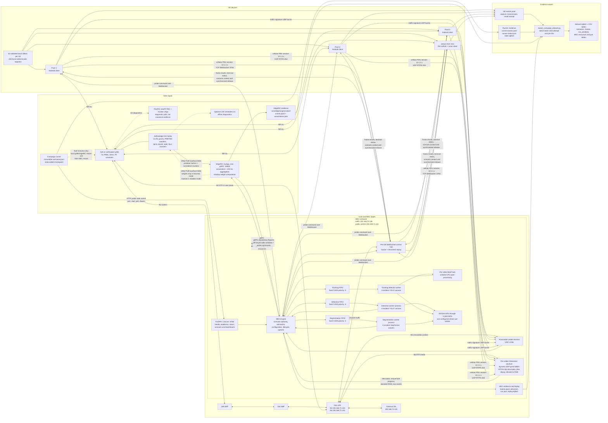

# Multi-UE system architecture audit

Audited 2026-11-02 from the implementation in `multi-ue/`,
`EdgeRIC-v2/muApp_mec/`, and
`gnb-core/ext/openairinterface5g/`. The diagram describes the deployed
51-PRB, no-channel-emulator, fixed-policy collection campaign. It separates
the implemented data path from optional or inactive control paths.

## Mermaid architecture diagram

## What the diagram establishes

### Scenario control

`generate_campaign_manifest.py` expands the campaign YAML and media inventory
into an immutable `scenarios.jsonl` and a hash-locked manifest. The runner is
the campaign orchestrator, but it does not directly configure a UE. It sends a
scenario assignment to the MEC's public-side HTTP endpoint. The MEC sends the
assignment to each already-connected UE over its WebSocket, waits for a fresh
readiness acknowledgement tied to that connection generation and admitted video,
and queues immediate-start commands for all assigned UEs before checking their
local write results. The runner polls MEC status, validates
150 terminal outcomes per assigned UE, checkpoints the attempt, and does not
regenerate a valid scenario.

The recovery hook is a separate exceptional path. It can recreate the local
gNB and EdgeRIC containers and can SSH to the MEC Spark to restart the MEC.
Normal scenario control does not use SSH.

### Application data plane

Android explicitly binds WebSocket, RTP, and probe sockets to the selected
cellular `Network`. The Linux client runs inside the softUE container's network
namespace and installs the MEC route through `oaitun_ue1`. Both therefore send
through the NR radio, gNB, GTP-U tunnel, UPF, N6 traffic network, and MEC
traffic-side address.

The UE encodes H.264 and repeats a fixed 96-byte descriptor in every RTP packet
for a frame. The descriptor carries video/frame/GoP/configuration identity,
encoded bytes, and capture/transmit timestamps. MEC parses the descriptor
before jitter buffering, counts unique received payload bytes, depayloads and
decodes with GStreamer, and then queues RGB frames by application.

Collection mode has one FIFO deque per application and one CUDA priority
(`-3`). There are three persistent worker processes. Each process holds four
frozen TorchScript model variants and one CUDA stream in the current campaign.
Detection returns YOLO boxes. Tracking uses the tracking YOLO worker followed
by serialized per-video ByteTrack state. Segmentation returns a SegFormer class
map encoded as row-major RLE. CUDA MPS is a host service shared by the three
worker processes.

Every terminal frame result is written without its large payload to
`jobs.jsonl`, written with its payload to `replay.sqlite3`, and sent to the UE.
The WebSocket reconnect path replays durable results in video/frame order.

### RAN telemetry and EdgeRIC

The OAI integration is compiled into `nr-softmodem`. Scheduler call sites copy
radio state and committed UL/DL grants into an in-process EdgeRIC bridge. The
bridge publishes protobuf metrics on localhost ZMQ port 5555. Cumulative
new-data and retransmission PRB/TBS counters allow EdgeRIC to compute deltas
even though its SUB socket is conflated.

EdgeRIC receives MEC awareness over gRPC, maintains per-video outstanding-byte
ledgers, and aggregates the OAI counter deltas into non-overlapping 100-ms
windows. It maps local C-RNTIs to opaque MEC UE IDs by serialized traffic
signatures: the MEC asks one UE at a time to send a known UDP pattern, EdgeRIC
correlates OAI `rx_bytes` by RNTI with the pattern, and the MEC supplies receipt
evidence. The local EdgeRIC log retains the RNTI. The report streamed to MEC
removes it and uses UE IDs.

The current campaign configures EdgeRIC in `shadow` mode and OAI in ordinary
proportional-fair scheduling. EdgeRIC computes and logs proposed weights but
does not publish them to ZMQ port 5556. Missing weights leave the OAI scheduler
on its configured PF behavior. The nearRT-RIC/monitor xApp path in the gNB
Compose file is independent diagnostic infrastructure and is not used by the
campaign exporter.

### Evidence and joins

The authoritative join key is
`campaign_id + scenario_id + attempt_id`. `video_id`, `frame_id`, `ue_id`, and
`ue_alias` add entity identity below the attempt. The configured MEC `run_id`
is currently the constant `collection-replace-me`; it is not sufficient to
identify a campaign attempt.

The exporter reads the campaign checkpoint and includes only the latest
attempt whose state is `valid`. It ingests MEC descriptors/resources/jobs,
local EdgeRIC radio reports, and separately collected UE logs. It produces
scenario, video, frame, radio-window, MEC-resource, and overlap/join tables.

## Audit findings and interpretation boundaries

1. **Initial radio reports can be structurally valid but unusable.** A new
   scenario context resets EdgeRIC's radio window. Until a traffic-signature
   association is valid, the report has `association_valid=false`, no RNTI,
   null MCS/SNR/RLC state, and zero attributable grants. These rows represent
   unavailable attribution and must not be treated as measured zero radio
   quality. A four-UE association cycle is serialized and can take many
   seconds.

2. **Radio evidence is 100-ms window evidence.** It is not a record for every
   slot or every frame. Grant totals come from differences of cumulative OAI
   counters. `latest_*_grant` and radio state are latest-value snapshots useful
   for validation, not exhaustive grant histories.

3. **Scheduled throughput is an estimate.** `throughput_bytes_s` converts
   scheduled new-data TBS with the configured payload fraction. It is not
   unique application goodput. MEC unique-byte progress and UE result receipts
   are separate evidence.

4. **Encoded bytes exclude transport overhead.** The descriptor's
   `encoded_bytes` counts canonical H.264 access-unit bytes. RTP, UDP, IP,
   PDCP, RLC, MAC, and PHY overhead are outside that value.

5. **GPU resource telemetry has a defined limit.** Queue and in-flight fields
   describe host-submitted work. NVML utilization describes the whole device.
   Neither measures per-stream kernel residency.

6. **The campaign validates terminal accounting, not universal inference
   success.** A valid scenario requires the expected final frame and exactly
   150 terminal outcomes per UE with no collection-level error. Individual
   terminal outcomes may still be `failed`; those reasons remain dataset
   features.

7. **FlexRIC is easy to confuse with the canonical RAN source.** The historical
   `EdgeRIC-v2/README.md` documents Redis, older muApps, and RL examples. The
   campaign implementation is `EdgeRIC-v2/muApp_mec/` and communicates
   directly with the OAI bridge over localhost ZMQ. The architecture diagram
   intentionally leaves FlexRIC on a dashed diagnostic edge.

8. **Exporter defect found during this audit.** EdgeRIC places
   `metric_age_s` at the report level. `export_campaign_dataset.py` currently
   reads `ue.get("metric_age_s")` while building `ran_windows`, so the exported
   `metric_age_s` column is null even when the raw report contains a value.
   Raw reports remain intact in `payload_json`; this should be corrected and
   covered by a regression test before relying on that database column.

9. **Evidence remains distributed.** UE logs live on each Pixel or the Orin,
   MEC logs live on the MEC Spark, and EdgeRIC/OAI/runner evidence lives on the
   RAN Spark. Export is a later explicit collection step; the runner does not
   automatically centralize every raw source.

10. **The current v2 campaign has no channel-emulator control path.** Its
    manifest sets `channels.enabled: false`; the runner skips CIR selection.
    The architecture therefore excludes the earlier ZMQ CIR loader from the
    active system.

## Principal source map

Detailed subsystem diagrams are available in
[`mec-internals-mermaid.md`](mec-internals-mermaid.md) and
[`edgeric-internals-mermaid.md`](edgeric-internals-mermaid.md). UE internals
are documented in
[`android-ue-internals-mermaid.md`](android-ue-internals-mermaid.md) and
[`linux-ue-internals-mermaid.md`](linux-ue-internals-mermaid.md).

| Responsibility | Implementation |
|---|---|
| Campaign expansion and immutable IDs | `multi-ue/tools/generate_campaign_manifest.py` |
| Checkpointed orchestration and validation | `multi-ue/tools/run_campaign.py` |
| Fault recovery | `multi-ue/scripts/campaign_recover.sh` |
| MEC HTTP/WebSocket/probe endpoints | `multi-ue/mec/src/mec_server/app.py` |
| MEC lifecycle, queues, joins, gRPC awareness | `multi-ue/mec/src/mec_server/engine.py` |
| RTP descriptor, assembly, jitter and decoding | `multi-ue/contracts/python/mec_contracts/rtp.py`, `multi-ue/mec/src/mec_server/media.py` |
| GPU workers and model execution | `multi-ue/mec/src/mec_server/workers.py` |
| Ordered tracking | `multi-ue/mec/src/mec_server/tracking.py` |
| Durable evidence and replay | `multi-ue/mec/src/mec_server/recording.py` |
| Android cellular control/media client | `multi-ue/ue/android/app/src/main/java/edu/clemson/mecrtp/` |
| Linux softUE client | `multi-ue/ue/linux/src/mec_ue/`, `multi-ue/scripts/softue-client.sh` |
| MEC/EdgeRIC protobuf service | `multi-ue/contracts/proto/mec_edgeric.proto` |
| EdgeRIC runtime and 100-ms reports | `EdgeRIC-v2/muApp_mec/runtime.py`, `telemetry.py` |
| UE-to-RNTI association | `EdgeRIC-v2/muApp_mec/association.py` |
| Outstanding radio demand ledger | `EdgeRIC-v2/muApp_mec/demand.py` |
| OAI ZMQ adapter | `EdgeRIC-v2/muApp_mec/oai_adapter.py` |
| OAI bridge and protobuf publication | `gnb-core/ext/openairinterface5g/executables/edgeric/` |
| OAI scheduler instrumentation/control hooks | `openair2/LAYER2/NR_MAC_gNB/gNB_scheduler*.c` |
| Joined dataset export | `multi-ue/tools/export_campaign_dataset.py` |

